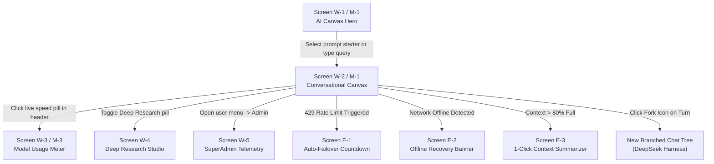

# 🎨 NamoGPT — Google Stitch Complete Design Specification (Web & Mobile)

> **Official Prompt & UI/UX Design System Specification for [Google Stitch](https://stitch.withgoogle.com/)**  
> *Upload or paste this document directly into Google Stitch to generate the complete multi-screen user interfaces, responsive design system, and interactive prototypes for both **Web** and **Mobile (iOS & Android)**.*

---

## 🌟 1. Project Vision & "Vibe Design" Prompt for Stitch

```text
Design a world-class, production-grade AI Workspace and Conversational Canvas called "NamoGPT".
Aesthetic: Modern Google Stitch Dark Obsidian & Glassmorphic AI Workspace.
Palette: Deep canvas black (#080a0f), elevated dark glass bento surfaces (#121622) with subtle hairline borders (rgba(255,255,255,0.08)), cyber cyan (#38bdf8), Google violet (#818cf8), and mint emerald (#10b981).
Feel: Ultra-fast, responsive, tactile micro-interactions, floating pill capsules, glowing focus rings, real-time telemetry meters, and clean typographic hierarchy.
Platforms: Responsive Web (Desktop 1440x900) and Mobile Native / PWA (iPhone 16 Pro & Android Material You 393x852).
```

---

## 🎨 2. Design System Tokens & Foundations

### 2.1 Color Tokens
| Token | Hex / Value | Purpose |
| :--- | :--- | :--- |
| `--canvas-bg` | `#080a0f` | Main background canvas |
| `--surface-base` | `#0f131d` | Sidebar and drawer background |
| `--surface-card` | `#141824` | Bento cards, message capsules, dialogs |
| `--surface-elevated`| `#1a2030` | Hover states, active dropdown items |
| `--border-subtle` | `rgba(255, 255, 255, 0.08)` | Hairline container borders |
| `--border-focused`| `rgba(56, 189, 248, 0.50)` | Glowing active input and focus rings |
| `--accent-cyan` | `#38bdf8` | Primary active states, web search badges |
| `--accent-violet`| `#818cf8` | Deep reasoning, chain-of-thought, AI avatars |
| `--accent-emerald`| `#10b981` | Speedometer gauge, success toasts, verified status |
| `--accent-rose` | `#f43f5e` | Voice dictation recording pulse, error alerts |
| `--text-primary` | `#f8fafc` | Main titles, user input, chat text |
| `--text-secondary`| `#94a3b8` | Subtitles, timestamps, token counts, captions |

### 2.2 Typography
- **Font Family**: `'Inter', -apple-system, BlinkMacSystemFont, 'Segoe UI', Roboto, sans-serif`
- **Code Font**: `'JetBrains Mono', 'Fira Code', 'Courier New', monospace`
- **Scale**:
  - `Display / Hero Title`: `32px / 1.2`, SemiBold, subtle linear gradient (`#ffffff` ➔ `#94a3b8`)
  - `Section Header`: `18px / 1.3`, Medium
  - `Body / Chat`: `15px / 1.6`, Regular
  - `Pills / Badges`: `12px / 1.2`, Medium
  - `Micro / Telemetry`: `11px / 1.1`, Mono

---

## 💻 3. Web Application Screens (Desktop: 1440 × 900px)

### Screen W-1: Modern AI Canvas Hero (Empty State)
- **Top Navigation Bar (`h-14`)**:
  - Left: Sidebar collapse button + Pill-shaped **Model Switcher** (`✨ Auto (Smart Router) | ⚡ ~300 t/s` with glowing cyan live dot).
  - Center/Right: **Live Model Usage Meter Pill** (`⚡ 284 t/s | 12.4k tok`), `+ New Chat` glowing pill, Persona tag, SuperAdmin badge, and Profile avatar.
- **Center Canvas**:
  - Soft ambient radial glow at top (`radial-gradient(circle at 50% 0%, rgba(56,189,248,0.06), transparent 70%)`).
  - Hero headline: *"What would you like to build or explore today?"* in gradient typography.
  - Subtitle: *"Powered by free multi-model intelligence with instant key rotation and real-time grounding."*
- **4 Bento Starter Cards Grid (`grid-cols-2 gap-4 max-w-3xl`)**:
  1. **⚡ High-Speed Coding**: Card with code terminal icon, prompt: *"Build a REST API with FastAPI and SQLite"* + Groq 300 t/s badge.
  2. **🧠 Deep Reasoning (R1)**: Card with purple brain icon, prompt: *"Analyze this algorithmic dynamic programming problem step-by-step"*.
  3. **🌐 Live Web Grounding**: Card with cyan globe icon, prompt: *"Search real-time breaking news and technological breakthroughs today"*.
  4. **👁️ Multimodal Vision**: Card with camera icon, prompt: *"Upload an architecture diagram or UI screenshot for deep OCR and analysis"*.
- **Floating Capsule Input Bar**:
  - Positioned at bottom center (`max-w-3xl w-full mx-auto pb-6`).
  - Pill shape (`rounded-3xl bg-[#121622]/90 border border-white/10 backdrop-blur-2xl shadow-2xl`).
  - Top action row: Feature toggle pills (`🌐 Web Search`, `🧠 Thinking Mode`, `🧭 Deep Research`, `📎 Attach`, `🎙️ Voice Dictation`).
  - Bottom action row: Token count pill (`~0 tok • 0c`) and glowing Send button.

---

### Screen W-2: Active Conversational Canvas (Streaming & Multi-Turn)
- **Message List Layout**:
  - **User Message**: Right-aligned compact dark capsule (`bg-zinc-800/90 border border-zinc-700/60 rounded-3xl rounded-tr-md px-5 py-3.5`).
  - **Assistant Message**: Left-aligned full-width canvas stream with glowing AI avatar badge.
- **Chain-of-Thought (R1) Accordion**:
  - Frosted violet card (`border border-violet-500/30 bg-violet-950/15 rounded-2xl p-3.5 mb-4`).
  - Header: Purple sparkle icon + *"Reasoning Process (3.2s live)"* + collapsible chevron.
  - Body: Italicized step-by-step internal monologue.
- **Web Grounding Citations**:
  - Horizontal carousel of interactive source cards with Google favicon, publisher domain chip, headline, and external link icon.
- **Interactive Code Block**:
  - JetBrains dark theme with language badge, line numbers gutter, and 1-click **Copy** button.
  - Integrated **"Run in Sandbox"** button with play icon.
  - Expandable terminal output drawer below code block showing exit code `0`, execution timer `2.1ms`, stdout, and stderr.
- **Turn Action Bar**:
  - Copy turn, Regenerate turn, Read aloud (TTS), Thumbs up/down, **Fork Chat from Here (🔀)**, and **Rewind Conversation (⏪)**.

---

### Screen W-3: Model Usage Meter Dialog / Drawer
- **Google Stitch Glassmorphic Modal (`max-w-2xl bg-[#0f131d]/95 backdrop-blur-2xl border border-white/10 rounded-3xl p-6`)**:
  - **Header**: Title *"Model Usage & Telemetry Meter"* + Live active generation pill + Close button.
  - **Live Radial Speedometer**:
    - SVG arc speedometer visualizing live tokens per second (`0` to `400+ t/s`).
    - LPU Tier indicator: `⚡ Groq Ultra LPU (~284 t/s)` or `Google Flash Ultra Context`.
  - **Session & Lifetime Token Grid**:
    - 4 High-contrast cards: `Prompt Tokens`, `Completion Tokens`, `Cached Tokens`, `Total Tokens`.
  - **Commercial Cost Savings Banner**:
    - Glowing emerald card: *"You saved ~$14.80 today vs OpenAI GPT-4o / Claude 3.5 Sonnet!"*.
    - Interactive "Celebrate" button triggering canvas confetti.
  - **Free Tier Quota Utilization Bars**:
    - `Google Gemini 2.5 Flash`: 15 RPM progress bar.
    - `Groq Cloud LPU`: 14,400 Requests/day progress bar.
    - `OpenRouter Free`: 200 Requests/day progress bar.
    - Color coding: Emerald (<60%), Amber (60-85%), Rose (>85%).
  - **Model Consumption Breakdown Bar**:
    - Segmented horizontal distribution bar showing usage percentage by model.

---

### Screen W-4: Autonomous Deep Research Canvas
- **Multi-Vector Query Decomposer**:
  - Left panel: Topic input + Research Plan view showing parallel search queries generated by AI.
  - Center panel: Real-time source extraction cards updating dynamically as sources are queried and validated.
  - Right panel: Live structured synthesis preview (Executive Summary, Technical Analysis, Source Citations).

---

### Screen W-5: SuperAdmin & Telemetry Diagnostic Console
- **Key Detection Status Grid**:
  - Live `.env` status indicators for Gemini (6 keys), Groq (3 keys), OpenRouter, NVIDIA NIM, Cloudflare, Supabase, and SMTP Mailer.
- **Prometheus Metrics Summary**:
  - Live HTTP requests counter, latency percentiles (P50, P95, P99), active connections gauge.
- **User Directory**:
  - Registered user directory with search, role badges (`superadmin`, `user`), and creation timestamps.

---

## 📱 4. Mobile Application Screens (iPhone 16 Pro & Android Material You: 393 × 852px)

### Screen M-1: Mobile Chat Canvas & Gesture Navigation
- **Header (`100dvh safe-area-inset-top`)**:
  - Hamburger menu icon (opens left sliding drawer with backdrop blur).
  - Center: Compact model switcher pill with speed icon (`✨ Auto | 300 t/s`).
  - Right: Mini usage meter badge (`⚡ 280 t/s`).
- **Main Chat Scroll Area**:
  - Touch-optimized message bubbles with long-press action sheet (Copy, Share, Fork, Rewind).
  - Pinch-to-zoom support on Vision images.
  - Collapsible reasoning accordion with touch toggle.

---

### Screen M-2: Floating Mobile Action Prompt Dock
- **Bottom Capsule Bar**:
  - Floating 12px above bottom navigation safe area.
  - Auto-growing multiline input with clean character counter.
  - Left icon: `+` pill opening feature drawer (Web Search, Thinking Mode, Document Scan, Camera Capture).
  - Center: Smooth typing field.
  - Right: Voice Dictation mic button with glowing rose pulse wave animation when listening.

---

### Screen M-3: Mobile Usage Meter Bottom Sheet
- **Draggable Bottom Sheet (`border-t border-white/10 rounded-t-3xl bg-[#0f131d]/98 backdrop-blur-2xl`)**:
  - Drag handle pill at top.
  - Compact radial speed gauge (`⚡ 280 t/s`).
  - Token tally cards and today's cost savings benchmark.
  - Quota progress bars with tap-for-details tooltip.

---

### Screen M-4: Mobile Code Execution Terminal Drawer
- Half-screen slide-up terminal with dark syntax output.
- Action buttons: Run Code (▶️), Copy Output, and Close.

---

## ⚠️ 5. Negative Flows & Edge-Case Screen States

### Screen E-1: Rate Limit (429) & Auto-Failover Notification
- **Visual Alert**:
  - Floating amber card (`border-amber-500/40 bg-amber-950/30 text-amber-200`).
  - Animated 1-second countdown ring: *"Rate limit active: resets in 38s"*.
  - Auto-failover pill: *"Automatically switched to Groq Llama 3.3 for zero downtime"*.
  - Action: 1-click button to enter secondary personal key in Settings.

### Screen E-2: Network Offline / Disconnection Banner
- **Visual Alert**:
  - Top frosted-glass banner with pulsing red offline indicator.
  - Text: *"You are currently offline. Prompts will queue and send once reconnected."*.
  - Instant *"Retry Connection"* button with spinning status.

### Screen E-3: Context Window Overflow Warning
- **Visual Alert**:
  - Visual capacity meter showing `85% of model context limit reached (~110k / 128k tokens)`.
  - Action button: *"Summarize Chat to Free Context"* — compresses earlier turns into a structured summary turn while preserving the active dialogue.

### Screen E-4: Application Error Recovery Screen (ErrorBoundary)
- **Visual Alert**:
  - Glass card with rose accent glow.
  - Title: *"Something went wrong with this view"*.
  - Action buttons: *"Reload Session"* and *"Clear Local Cache"*.
  - Collapsible technical diagnostic view with 1-click stack trace copy.

---

## 🚀 6. Stitch Interactive Prototype Flow Map



---

## 📋 7. How to Use with Google Stitch

1. Navigate to **[stitch.withgoogle.com](https://stitch.withgoogle.com/)**.
2. Start a new project named **"NamoGPT Multi-Model AI Canvas"**.
3. Copy and paste the **Project Vision & Vibe Design Prompt** from **Section 1** into the primary Stitch prompt window.
4. Prompt Stitch to generate the screens in order using the section specs:
   - *"Generate Screen W-1: Modern AI Canvas Hero with 4 Bento starter cards and floating capsule input bar."*
   - *"Generate Screen W-2: Conversational Canvas with Chain-of-Thought reasoning accordion and code execution terminal."*
   - *"Generate Screen W-3: Model Usage Meter modal with SVG radial speedometer, token cards, and quota bars."*
   - *"Generate Screen M-1 and M-2: Mobile responsive view (393px) with floating action dock."*
5. Link screens together using the **Flow Map in Section 6** to preview the full interactive prototype!
